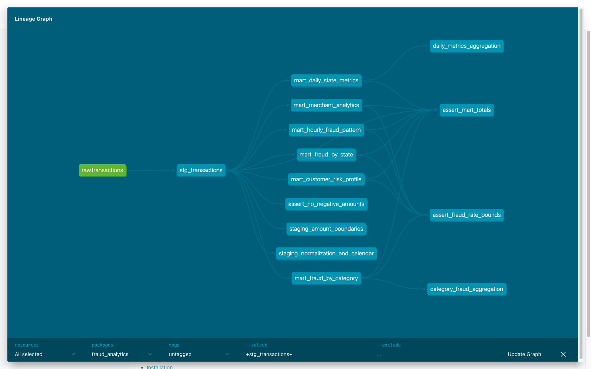

# MLOps-hw4

Анализ транзакций и фрода в dbt: `raw → staging → marts`.
Загрузка Kafka → ClickHouse взята из [ДЗ №2](https://github.com/kryalka/MLOps-hw2),
размеченный датасет из [ДЗ №3](https://github.com/kryalka/MLOps-hw3).

Версии: dbt-core 1.10.15, dbt-clickhouse 1.9.5.

## Запуск

Нужны Python 3.12, Docker Compose и make. Команды выполняются из корня проекта.
Положите `train.csv` с колонкой `target` в `data/`.
Задайте пароль ClickHouse; для уже созданной базы используйте её текущий пароль.

```bash
python3.12 -m venv .venv
.venv/bin/python -m pip install -r dbt/requirements.txt
export CLICKHOUSE_PASSWORD='your-password'
docker compose up -d --wait --wait-timeout 180
docker compose run --rm producer --file data/train.csv
```

Дождитесь загрузки всех 786431 строк:

```bash
docker compose exec -T clickhouse clickhouse-client --user hw2 --password "$CLICKHOUSE_PASSWORD" \
  --query "SELECT count() FROM transactions_db.transactions"
```

Повторно отправлять CSV не нужно: это создаст дубли.

```bash
make -C dbt build
make -C dbt docs
make -C dbt serve
```

`build` устанавливает пакеты, строит модели и запускает тесты.
Документация: http://localhost:8085. Остановка: `docker compose down`.

## Витрины

| Модель | Содержание |
|---|---|
| `mart_daily_state_metrics` | По дате и штату: количество, сумма, средний чек, P95, доля крупных операций |
| `mart_fraud_by_category` | По категории: число фродов, fraud_rate и суммы |
| `mart_fraud_by_state` | По штату: fraud_rate, уникальные клиенты и мерчанты, суммы |
| `mart_customer_risk_profile` | История клиента, средний чек и риск HIGH/MEDIUM/LOW |
| `mart_hourly_fraud_pattern` | Фрод по дням недели и часам, окна повышенного риска |
| `mart_merchant_analytics` | Оборот, fraud_rate и флаг подозрительности мерчанта |

В `stg_transactions` приводятся типы, очищаются строки, вычисляются ключ клиента,
дата, час, день недели и сегмент суммы через макрос `amount_bucket`.
Используются пакеты `dbt_utils`, `dbt_date`, `dbt_expectations`.
Описания колонок и правила расчёта находятся в YAML рядом с моделями.

## Проверка

```bash
make -C dbt test
make -C dbt lint
.venv/bin/pre-commit install
```

Есть базовые тесты, проверки уникальности ключей витрин, 3 singular tests и 4 unit tests.
[Лог dbt test](docs/dbt-test.txt): `PASS=100 WARN=0 ERROR=0 SKIP=0`.
Конфиги: `dbt/.sqlfluff` и `.pre-commit-config.yaml`.


